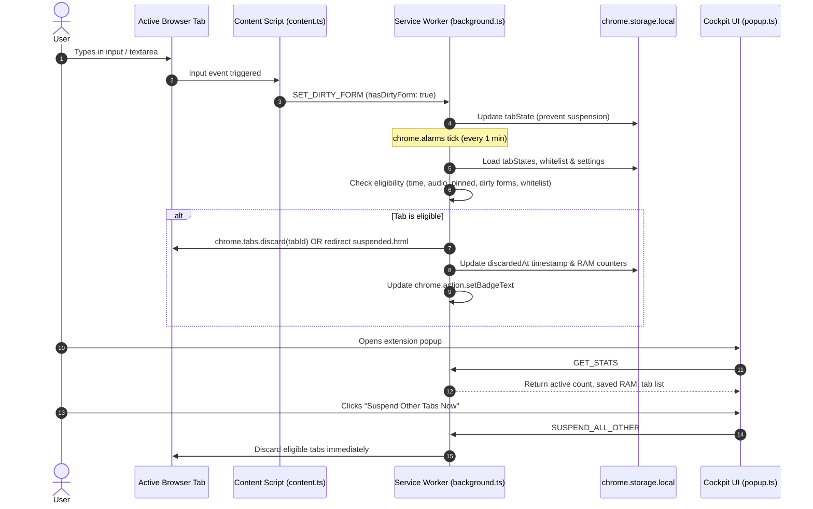

# 🛡️ TabSaver Pro

**Automatically suspend inactive browser tabs to reduce RAM consumption.**

A high-performance, production-ready Manifest V3 browser extension for Chrome, Edge, and Brave. TabSaver Pro monitors tab inactivity, respects active tasks, and automatically puts idle tabs to sleep — reclaiming gigabytes of RAM without losing your place.

---

## 📑 Table of Contents

- [Features](#-features)
- [Visual Cockpit & UI](#-visual-cockpit--ui)
- [Architecture & Data Flow](#-architecture--data-flow)
- [Tech Stack](#️-tech-stack)
- [Project File Structure](#-project-file-structure)
- [Quick Start & Installation](#-quick-start--installation)
- [Troubleshooting & Common Pitfalls](#-troubleshooting--common-pitfalls)
- [Configuration & Safety Rules](#️-configuration--safety-rules)
- [How It Works Under the Hood](#-how-it-works-under-the-hood)
- [Testing & Manual Verification](#-testing--manual-verification)
- [Browser Compatibility](#-browser-compatibility)
- [Privacy & Security Guarantee](#-privacy--security-guarantee)
- [FAQ](#-frequently-asked-questions)
- [Contributing](#-contributing)
- [License](#-license)

---

## ✨ Features

- **⚡ Automated Inactivity Suspension** — Suspends tabs after an inactivity threshold (5m / 15m / 30m / 1h / Off) without waking sleep cycles.
- **🛡️ Bulletproof Safety Rules**:
  - 🔊 **Audio Protection** — Never suspends tabs playing audio or participating in video calls (`tab.audible`).
  - 📌 **Pinned Tab Protection** — Keeps essential pinned workspaces intact (`tab.pinned`).
  - ✍️ **Unsaved Form Guardian** — Content script tracks dirty `<form>`, `<input>`, `<textarea>`, and `[contenteditable]` elements so you never lose in-progress drafts.
  - 🔋 **Battery-Aware Mode** — Option to only suspend tabs when running on battery power (`navigator.getBattery()`).
- **🌐 Dual Suspension Modes**:
  - **Native Discard** (`chrome.tabs.discard`) — Chrome frees process memory while preserving scroll position and tab history.
  - **Sleeping Placeholder Mode** (`suspended.html`) — Redirects tabs to an ultra-lightweight (~2 MB) custom page with title, favicon, and a one-click restore banner. Prevents tab-switch reload storms.
- **🏷️ Domain Whitelist Engine** — Exclude specific sites with exact (`localhost`, `github.com`) or wildcard (`*.figma.com`, `*.slack.com`) patterns.
- **🟢 Live Toolbar Badge** — Real-time badge counter on the toolbar icon indicates active sleeping tabs at a glance.
- **📊 Real-time Memory Metrics** — Calculates estimated RAM savings (~70 MB per discarded tab) and lifetime statistics.
- **🎨 Anti-Slop UI & Design System** — Built using strict 8px spatial grid, high-contrast typography, zero-framework CSS tokens, and automatic dark/light theme switching.

---

## 🖥️ Visual Cockpit & UI

### 1. Popup Cockpit (320px × 420px)

```
┌─────────────────────────────────────────┐
│  🛡️ TabSaver Pro                ⚙️      │
├─────────────────────────────────────────┤
│  ┌───────────────┐   ┌────────────────┐ │
│  │      12       │   │    ~840 MB     │ │  ← Live Counters
│  │ Tabs Sleeping │   │   RAM Saved    │ │
│  └───────────────┘   └────────────────┘ │
│  [██████████████████░░░░] 75% suspended │  ← Visual Ratio Bar
├─────────────────────────────────────────┤
│  [ 🛑 Suspend Other Tabs Now          ] │  ← Instant Action CTA
│                                         │
│  github.com  ────────────── [🔒 Active] │  ← Instant Whitelist Toggle
│                                         │
│  [ 5m ] [ 15m ] [ 30m ] [ 1h ] [ Off ]  │  ← Segmented Inactivity Pills
├─────────────────────────────────────────┤
│  Suspended Tabs                         │
│  ┌─ 🌐 Pull Request #142 · github... ─┐ │
│  │                                [×] │ │  ← Click to wake,
│  ├─ 🌐 Linear Workspace               ─┤ │     [×] to close
│  │                                [×] │ │
│  └────────────────────────────────────┘ │
└─────────────────────────────────────────┘
```

### 2. Custom Sleeping Placeholder Page (`suspended.html`)

```
┌────────────────────────────────────────────────────────┐
│                                                        │
│                      [ 🌐 Favicon ]                    │
│                                                        │
│                 Pull Request #142 · GitHub             │
│              https://github.com/org/repo/pull/142      │
│                                                        │
│             💤 Tab is sleeping to conserve memory      │
│                  (Click anywhere to wake)              │
│                                                        │
│            [ 📋 Copy URL ]      [ ✕ Close Tab ]        │
│                                                        │
└────────────────────────────────────────────────────────┘
```

---

## 🔄 Architecture & Data Flow



---

## 🛠️ Tech Stack

- **Standard**: Chromium Manifest V3 (MV3 compliant)
- **Language**: Strict TypeScript (`noImplicitAny`, `strictNullChecks`, typed Chrome API)
- **Styling**: Native CSS custom properties, Flexbox & CSS Grid (zero Tailwind/React bloat)
- **Runtime Environment**: Service Worker (`background.ts`) + Isolated Page Contexts
- **APIs**:
  - `chrome.tabs` — Querying active states, discarding tabs, restoring URLs
  - `chrome.alarms` — Reliable, persistent background timers resilient to SW termination
  - `chrome.storage.local` — State persistence across browser sessions
  - `chrome.scripting` / Content Scripts — Form state inspection & visual tab dimming
  - `chrome.action` — Dynamic emerald badge count and color states

---

## 📁 Project File Structure

```
Ram extension/
├── manifest.json              # MV3 Configuration, permissions & entry points
├── package.json               # Build tools & scripts
├── tsconfig.json              # Strict TS compiler configuration (module: None, ES2020)
├── README.md                  # Comprehensive documentation
├── icons/
│   ├── icon.svg               # Vector source icon
│   ├── icon16.png             # Toolbar display (16x16)
│   ├── icon48.png             # Extensions manager (48x48)
│   └── icon128.png            # Web Store & installation preview (128x128)
├── src/
│   ├── types.ts               # Global TypeScript definitions & storage models
│   ├── background.ts          # Core service worker engine & alarm processor
│   ├── content.ts             # Injected form guardian & DOM watcher
│   ├── styles/
│   │   └── tokens.css         # Shared design tokens (colors, 8px grid, typography)
│   ├── popup/
│   │   ├── popup.html         # Cockpit popup layout
│   │   ├── popup.css          # Cockpit popup styling & dark theme
│   │   └── popup.ts           # Cockpit interaction logic
│   ├── options/
│   │   ├── options.html       # Preferences & domain whitelist manager
│   │   ├── options.css        # Settings layout styling
│   │   └── options.ts         # Settings persistence & auto-save
│   └── suspended/
│       ├── suspended.html     # Minimalistic sleeping tab placeholder layout
│       ├── suspended.css      # Sleeping tab animations & card styling
│       └── suspended.ts       # Wake-on-click & URL restore engine
└── dist/                      # Production compiled JavaScript files
    ├── background.js
    ├── content.js
    ├── popup/popup.js
    ├── options/options.js
    └── suspended/suspended.js
```

---

## 🚀 Quick Start & Installation

### 1. Build the Extension

Ensure you have [Node.js](https://nodejs.org/) installed:

```bash
# Navigate to the project directory
cd "/home/firahs/Desktop/All project/Ram extension"

# Install dev dependencies
npm install

# Compile TypeScript into dist/
npm run build
```

### 2. Load into Your Browser

1. Open your browser and navigate to the extensions page:
   - **Chrome**: `chrome://extensions`
   - **Brave**: `brave://extensions`
   - **Edge**: `edge://extensions`
2. Enable **Developer mode** in the upper-right corner.
3. Click the **Load unpacked** button.
4. Select the **root project directory** (`Ram extension/` containing `manifest.json`).
5. Pin **TabSaver Pro** to your browser toolbar for quick access.

---

## ⚠️ Troubleshooting & Common Pitfalls

### Common Error: "Could not load icon 'icons/icon16.png' specified in 'action'"
- **Cause**: Clicking "Load unpacked" and selecting the `dist/` subfolder instead of the project root.
- **Solution**: Always select the **root project folder** where `manifest.json` and the `icons/` directory are located.

### Common Error: "Cannot use import statement outside a module"
- **Cause**: Chrome Manifest V3 content scripts and service workers do not support raw ES module `import` syntax unless bundled or loaded as modules.
- **Solution**: TabSaver Pro compiles with `"module": "None"` and isolates files using clean IIFE enclosures (`(() => { ... })()`). If editing source code, run `npm run build` to update `dist/`.

### Tab Not Suspending Automatically
- Verify the tab is not playing audio (Spotify, YouTube, Google Meet).
- Verify the tab is not pinned.
- Verify you do not have unsaved text in any text field or comment box.
- Check if the domain is listed under the **Whitelist** in Options.
- Confirm the timer in the popup is not set to **Off**.

---

## ⚙️ Configuration & Safety Rules

Navigate to `src/options/options.html` or click the **gear icon** in the popup:

| Setting Option | Default | Purpose |
|---|---|---|
| **Never suspend tabs playing audio** | `Enabled` | Prevents interruption of music, audiobooks, podcasts, and video meetings. |
| **Never suspend pinned tabs** | `Enabled` | Preserves permanently pinned work utilities (e.g. email, chat). |
| **Never suspend unsaved form tabs** | `Enabled` | Prevents loss of comments, forms, issue descriptions, and draft messages. |
| **Only auto-suspend on battery** | `Disabled` | Conserves battery power on laptops; keeps tabs alive while plugged into wall AC. |
| **Use Sleeping Placeholder page** | `Disabled` | When active, redirects to `suspended.html` instead of native `chrome.tabs.discard()`. |
| **Visual tab dimming (💤 title prefix)** | `Disabled` | Prepends `💤 ` to document title right before suspending so you can see sleeping tabs at a glance. |

### Whitelist Syntax
Enter one pattern per line in the options manager:
```text
localhost
mail.google.com
*.github.com
*.figma.com
127.0.0.1:3000
```
- `domain.com` matches `domain.com` directly.
- `*.domain.com` matches any subdomain (`app.domain.com`, `api.domain.com`).

---

## 🧪 Testing & Manual Verification

To test the extension thoroughly:

1. **Verify Manual Suspension**:
   - Open 5 tabs with random websites (e.g., Wikipedia, MDN, GitHub).
   - Click the TabSaver Pro toolbar icon.
   - Click **"Suspend Other Tabs Now"**.
   - Watch the badge update with the number of sleeping tabs, and notice memory reduction in Chrome Task Manager (`Shift + Esc`).
2. **Verify Form Protection**:
   - Open a tab with a comment box or form (e.g., GitHub issue or form field).
   - Type some text without submitting.
   - Open the popup and click "Suspend Other Tabs Now".
   - Confirm that the dirty tab remains active and is **never** suspended.
3. **Verify Audio Protection**:
   - Start playing a YouTube video or Spotify playlist in a background tab.
   - Trigger suspension.
   - Confirm audio continues uninterrupted and the tab is spared.
4. **Inspect Background Worker**:
   - Go to `chrome://extensions`.
   - Click **"Inspect views: service worker"** under TabSaver Pro.
   - View live logs of alarm triggers, inactivity checks, and memory evaluations.

---

## 🌐 Browser Compatibility

| Browser | Supported | Engine | Notes |
|---|---|---|---|
| **Google Chrome** | ✅ 100% | Chromium | Full Manifest V3 compatibility |
| **Brave Browser** | ✅ 100% | Chromium | Compatible with Brave Shields |
| **Microsoft Edge** | ✅ 100% | Chromium | Full support |
| **Opera / Opera GX** | ✅ 100% | Chromium | Supported via developer mode |
| **Vivaldi** | ✅ 100% | Chromium | Supported |

---

## 🔒 Privacy & Security Guarantee

- **100% Local & Offline**: TabSaver Pro runs entirely inside your browser. No external network requests, analytics, or telemetry are ever made.
- **Zero Data Collection**: Your URLs, titles, and form inputs are never stored externally or sent to any server. Form contents are never read — only dirty/pristine state flags are tracked locally.
- **Minimal Permissions**: Only requests strictly necessary browser extension APIs (`tabs`, `alarms`, `storage`, `scripting`, `activeTab`).

---

## ❓ Frequently Asked Questions

#### Q: How is this different from Chrome's built-in Memory Saver?
> Chrome's Memory Saver uses opaque heuristics that often suspend tabs you need or fail to suspend tabs you don't. TabSaver Pro gives you explicit, predictable rules: customizable timeouts, granular whitelisting, dirty form safety, one-click immediate suspension, and full visibility through the live toolbar badge and cockpit popup.

#### Q: Will I lose my place or unsubmitted form data?
> No! Unsaved form detection watches every `<input>`, `<textarea>`, and `contenteditable` container. Any tab containing typed text will never be auto-suspended.

#### Q: What happens when I click a suspended tab?
> In native mode, Chrome instantly reactivates and restores the tab's DOM. In placeholder mode, clicking anywhere on the page navigates directly back to the original URL.

---

## 🤝 Contributing

1. Fork the repository.
2. Create a clean feature branch:
   ```bash
   git checkout -b feature/awesome-feature
   ```
3. Commit your changes and verify compilation:
   ```bash
   npm run build
   ```
4. Push your branch and open a Pull Request.

---

## 📄 License

This project is licensed under the **MIT License**. Free for personal, open-source, and commercial use.
